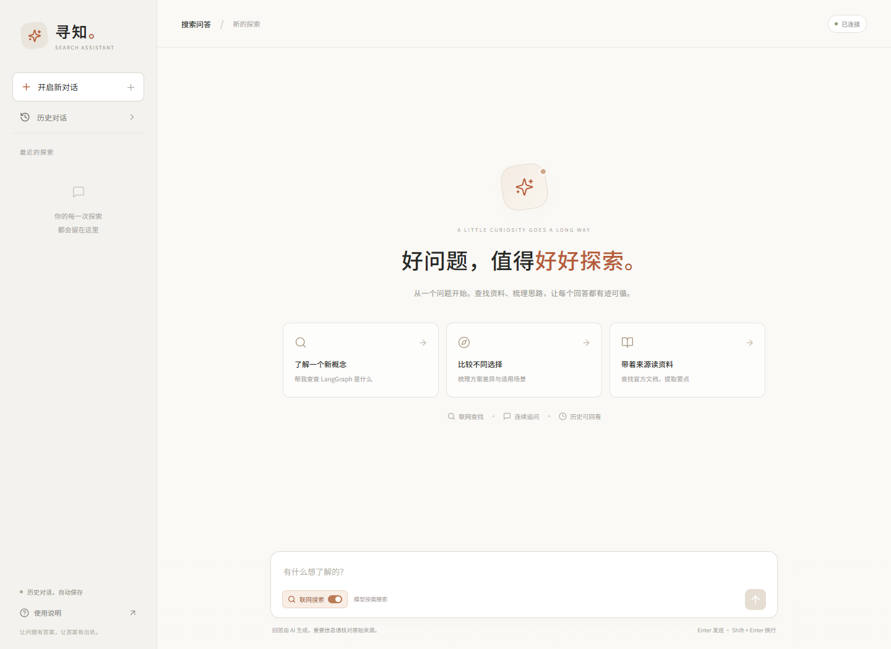
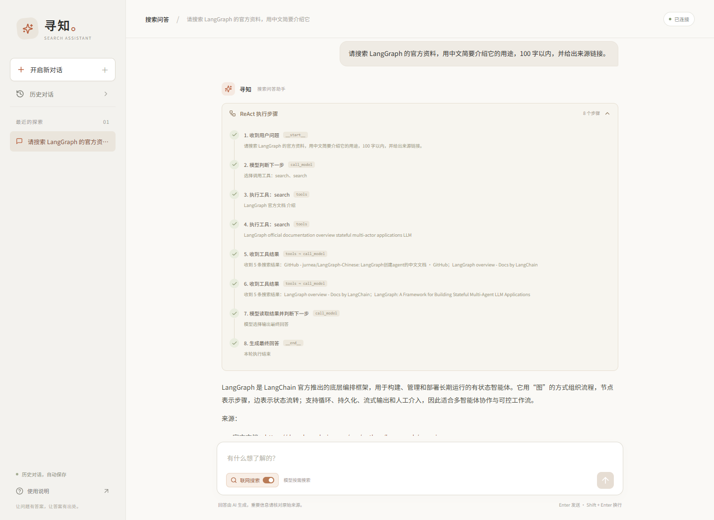
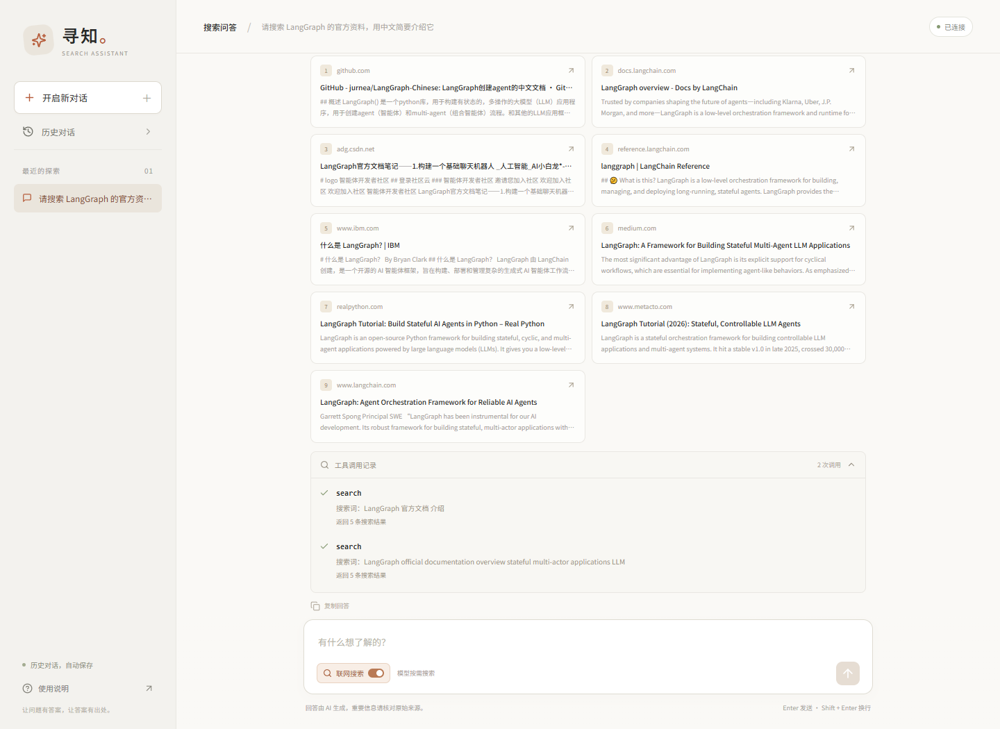
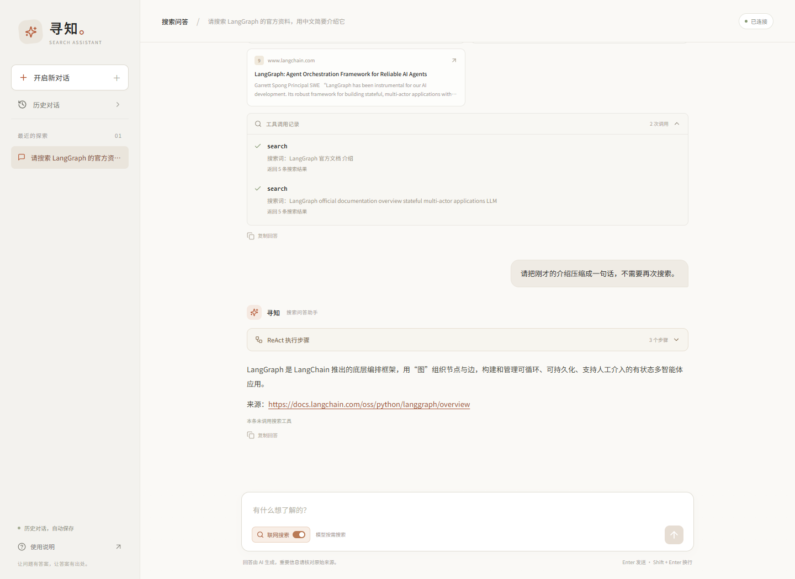
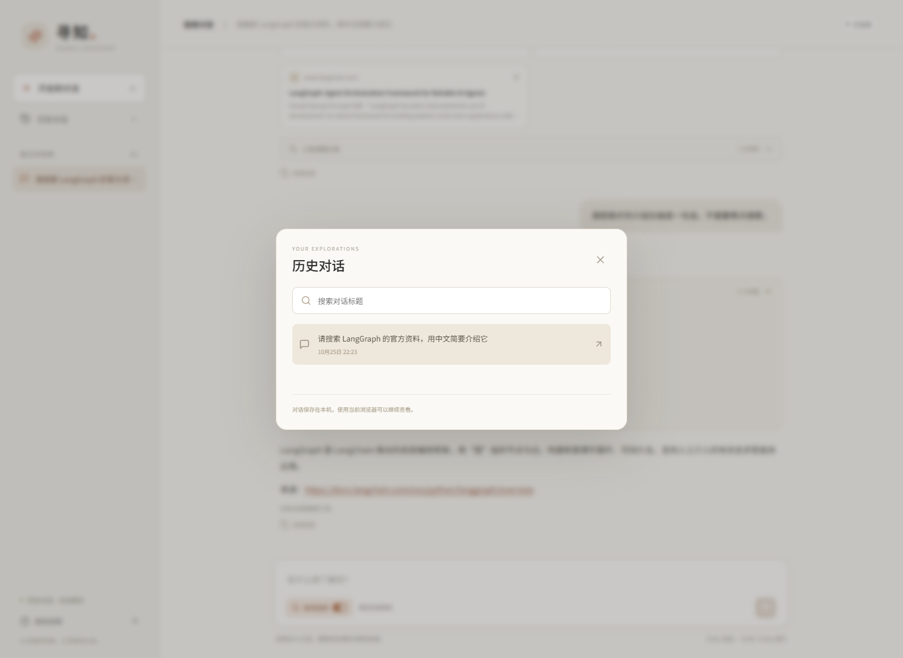

# 效果展示

寻知是一款基于 LangGraph 的搜索问答助手，支持多轮问答、联网搜索、工具执行过程查看与历史恢复。

以下图片来自本地应用，使用此前真实联网问答后保存在 SQLite 中的记录，在当前版本页面中恢复展示。截图包含 2 次真实搜索、9 个去重来源及后续追问，刷新后记录可恢复。采集时模型兼容接口超时，Tavily 直连检查正常；截图展示已有真实记录，不代表当前模型服务可用性。启动方式见 [README](../README.md)。

## 1. 问题输入与联网开关

首页提供直接提问与示例问题入口。联网开关决定本轮是否允许使用搜索工具；允许后由模型按需决定是否搜索以及搜索词。

## 2. ReAct 执行过程

提交“搜索 LangGraph 官方资料”的问题后，页面记录收到问题、模型选择工具、执行搜索、观察结果和输出回答等步骤。运行期间按检查点轮询更新，完成后随历史会话保存。

这里展示可观察的节点、工具参数和返回摘要。

## 3. 搜索结果与工具记录

回答下方展示工具实际返回的来源标题、链接和摘要；工具记录可查看搜索词和成功/失败状态。来源卡片用于核验搜索材料，不意味着每条材料都被正文引用。

## 4. 连续追问

在同一会话继续提问，服务端通过 `thread_id` 恢复上下文。示例追问基于已有对话生成回答，本轮没有调用搜索工具。

## 5. 历史会话

刷新页面后仍可读取完整对话；历史弹窗支持按标题筛选和切换。会话元数据与 LangGraph 检查点保存在本地 SQLite 文件中。

## 可复现步骤

1. 按 README 配置支持工具调用的模型接口和 Tavily 密钥，启动前后端
2. 开启联网搜索，输入：`请搜索 LangGraph 的官方资料，用三点说明它的用途，并附上来源链接，回答不超过150字。`
3. 查看 ReAct 执行步骤、回答、搜索来源与工具记录
4. 关闭联网搜索，在同一会话追问：`根据刚才的资料，它如何保存会话状态？用两句话回答。`
5. 刷新页面并打开历史对话，验证会话可恢复

实际检索结果、模型回答和步骤数量随所选模型与搜索服务返回变化。
